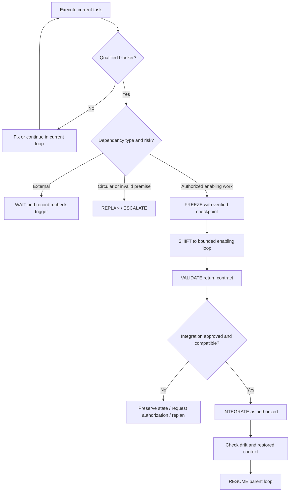

# DDLS — Dependency-Driven Loop Shifting

**A practical engineering playbook for dependency-aware software development with AI coding agents.**

**Version:** 2.1 — Agent Reliability & Execution Safety  
**Framework author:** Ali Mohammed  
**Year:** 2026

> **Core principle:** Preserve Intent. Qualify Dependencies. Isolate Enablement. Verify Outcomes. Resume Safely.

## What is DDLS?

DDLS is a workflow for handling unexpected prerequisites discovered during software development. When a genuine dependency blocks a task, DDLS helps engineers preserve the original objective, isolate the necessary enabling work, verify its outcome, and safely resume the suspended task.

**Freeze → Shift → Enable → Validate → Integrate → Resume**

DDLS does not require a shift for every bug. Routine issues stay within the current task. It supports direct fixes, external waiting, architectural replanning, parallel enabling work, escalation, and cancellation when appropriate.

## Start here

| Resource | Use it for |
|---|---|
| [Full DDLS v2.1 playbook](docs/DDLS-v2.1.md) | Normative day-to-day workflow and engineering rules |
| [Quickstart](docs/QUICKSTART.md) | A short decision procedure and worked flow |
| [AGENTS.md](AGENTS.md) | Standing instructions for AI coding agents |
| [Task-start prompt](prompts/task-start.md) | Scope, acceptance, and authority for a particular task |
| [Templates](templates/) | Primary-loop, shift, checkpoint, return-contract, and reporting records |
| [Worked example](examples/backup-package-verification.md) | Freeze / shift / enable / validate / resume without production changes |
| [Publishing guide](docs/PUBLISHING.md) | GitHub setup and release tagging |
| [License](LICENSE) and [Attribution](ATTRIBUTION.md) | Permitted reuse and credit to the framework author |
| [Change history](CHANGELOG.md) | Version notes |
| [Contributing](CONTRIBUTING.md) | How to report issues and contribute improvements |

## The DDLS decision path

## Five-minute adoption

1. **Set the objective.** Define allowed scope, prohibited changes, acceptance criteria, and authorities using [task-start.md](prompts/task-start.md).
2. **Work normally.** Fix routine problems without opening new loops.
3. **Qualify blockers.** Shift only when evidence establishes a missing prerequisite that cannot be resolved safely within scope.
4. **Checkpoint and contract.** Save reconstructable state; write the enabling loop's return contract.
5. **Verify and resume.** Confirm acceptance, integration authority, drift, and parent readiness before continuing.

**Default retry recommendation:** No more than three substantially similar repair attempts per hypothesis without material new evidence. This is configurable, and critical safety or authorization violations require immediate stopping.

## Using DDLS with AI coding agents

Read the [agent instructions](AGENTS.md) and provide the [per-task contract](prompts/task-start.md). When adopting DDLS in an existing repository, **merge these instructions with the project's existing agent rules rather than overwriting them**. Project-specific safety and access controls take precedence over generic examples.

Agents may propose shifts and generate records. They may not infer permission to expand scope, merge, deploy, change protected infrastructure, or perform sensitive operations.

## Files and examples

The `templates/` directory contains YAML records that can be filled in manually or generated by an agent. The templates are examples of a human-readable record format, **not a formally validated wire protocol or a production orchestration engine**.

The example demonstrates a fictional backup-development dependency; it does not represent a live deployment.

## Design scope

DDLS complements, rather than replaces, software architecture, version control, CI/CD, code review, security engineering, incident response, and project management. It does not guarantee that every dependency can be resolved, that every change is reversible, or that every project will be faster.

## Licensing, reuse, and attribution

**You are welcome to adapt DDLS, translate it, build tools for any programming language, integrate it into AI coding assistants, and use it in commercial or proprietary products.**

The repository uses **two permissive licenses**, depending on the file:

| Materials | License | Key conditions |
|---|---|---|
| Framework documentation (`docs/`, `README.md`, `examples/`, etc.) | [CC BY 4.0](https://creativecommons.org/licenses/by/4.0/) | Attribution, license link, and indication of adaptations when shared |
| AI-agent instructions, prompts, and reusable templates (`AGENTS.md`, `prompts/`, `templates/`, `.github/`) | [Apache-2.0](https://www.apache.org/licenses/LICENSE-2.0) | Retain required license and attribution notices, including relevant `NOTICE` material |

**Originally conceived and authored by Ali Mohammed (2026).** See the [license map](LICENSE), [NOTICE](NOTICE), and [attribution guide](ATTRIBUTION.md).

Preferred acknowledgement: *“Based on DDLS (Dependency-Driven Loop Shifting), originally conceived and authored by Ali Mohammed (2026).”*

Independent implementations of abstract DDLS ideas are welcome under any software license; credit is requested, but copyright licensing does not necessarily make such attribution legally mandatory without reuse of protected materials. Attribution must not imply endorsement by the author.

## Version

See [CHANGELOG.md](CHANGELOG.md). This is the **v2.1 operational playbook**, not a certification that all usage scenarios have been experimentally validated.
